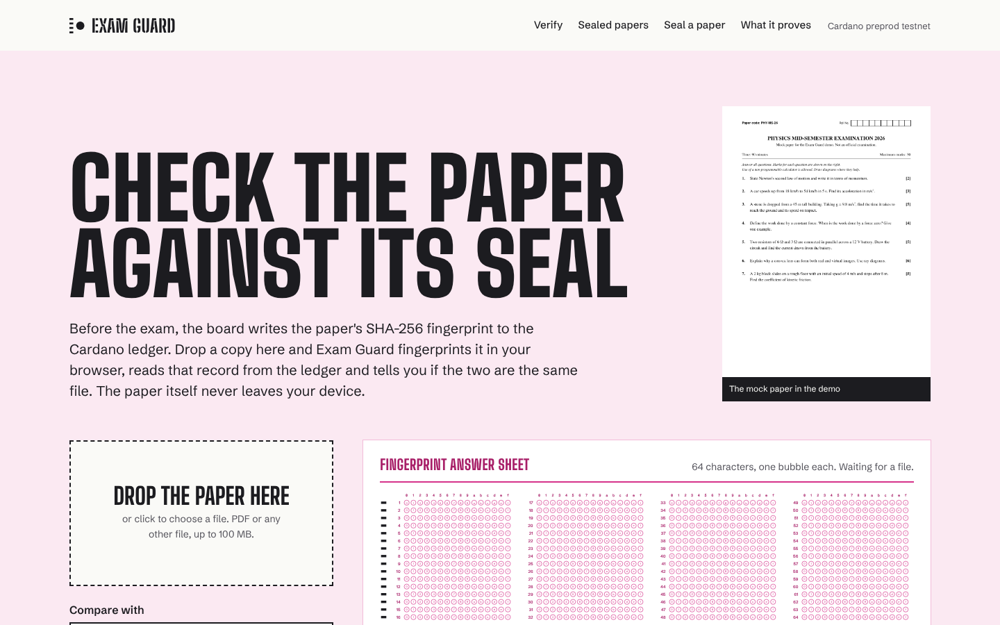
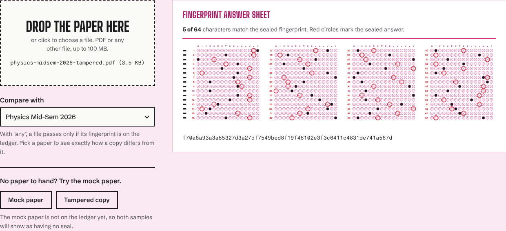

<div align="center">

# 🛡️ Exam Guard

### Secure • Verify • Trust

**A Cardano-powered blockchain solution for tamper-proof examination paper verification.**

[](https://cardano.org/)
[](https://developer.mozilla.org/)
[](https://python.org/)
[](https://nodejs.org/)
[](https://github.com/victorisaacchinta-eng/exam-guard/actions/workflows/tests.yml)

### 🌐 Live Demo
https://exam-guard-omega.vercel.app/

### 🎥 Demo Video
**Google Drive:** https://drive.google.com/file/d/1sXR9mOqK5YMvGcDiGwAs2gK5gdVEfdBQ/view?usp=sharing
project explanation: https://drive.google.com/file/d/1-dGr4JPrZXWST7tjCecA-65Whl8Ph4X3/view?usp=sharing

</div>

---



# 📖 Overview

**Exam Guard** is a blockchain-based verification platform designed to catch examination paper tampering.

Instead of trusting a centralized database, every official examination paper is converted into a **SHA-256 cryptographic hash** and recorded on the **Cardano blockchain** (preprod testnet) from the exam board's wallet.

Whenever someone wants to verify an examination paper, Exam Guard hashes the uploaded file in the browser, reads the seal transaction from the ledger and compares the two.

If both hashes match:

> ✅ The document is authentic.

Otherwise:

> ❌ The document has been altered, or it is a different file.

Version 2 reads the seal from Cardano every time. The hackathon version compared uploads with a hash written into the page itself, so it never actually asked the chain.

---

# ❗ Problem Statement

Educational institutions continuously struggle with:

- Examination paper leaks
- Unauthorized modifications
- Fake question papers
- Lack of transparent verification
- Centralized systems vulnerable to manipulation

Current verification systems rely on trust.

Exam Guard replaces trust with **cryptographic proof.**

---

# 💡 Our Solution

Exam Guard uses the immutability of the **Cardano blockchain** to keep a public, timestamped record of each paper's fingerprint.

### Workflow

```
Official Exam Paper
        │
        ▼
Generate SHA-256 Hash
        │
        ▼
Store Hash on Cardano Blockchain  (metadata label 674, signed by the board's wallet)
        │
        ▼
User uploads paper
        │
        ▼
Generate SHA-256 Again  (in the browser, the file is never uploaded)
        │
        ▼
Read the seal from the ledger and compare
        │
        ▼
Authentic ✅   or   Tampered ❌
```

---

# ✨ Features

- 🔒 SHA-256 document hashing, done locally with the Web Crypto API
- ⛓️ Live Cardano reads: every check fetches the seal transaction through Koios
- ✍️ Signer check: a seal only counts if it was sent from the wallet listed for that board
- 📄 Fingerprint answer sheet: the 64 hex characters drawn as an OMR sheet, with every differing character circled in red
- 🧾 Receipt with both fingerprints, block, confirmations, transaction and wallet, each one copyable
- 📚 Register of sealed papers, each row checked against the ledger when the page opens
- 🏷️ Seal a paper: fingerprint a final PDF, get the exact ledger record and the command that publishes it
- 🛡️ Clear failure states: "no seal on file", "seal broken", "ledger unreachable" and "record problem" are never confused



---

# 🏗️ Project Architecture

```
                  User
                    │
                    ▼
             Upload Exam PDF
                    │
                    ▼
        SHA-256 in the browser (Web Crypto)
                    │
                    ▼
     registry.json: which transactions to read
                    │
                    ▼
   /api/ledger (Vercel function) ──► Koios ──► Cardano preprod
                    │
        ┌───────────┴───────────┐
        ▼                       ▼
 Fingerprint + signer      Uploaded file's
 from the ledger           fingerprint
        │                       │
        └───────────┬───────────┘
                    ▼
             Verification Engine (assets/core.js)
                    │
         ┌──────────┴──────────┐
         ▼                     ▼
     Authentic ✅         Tampered ❌
```

The small server function exists because Koios answers CORS preflight requests but leaves `Access-Control-Allow-Origin` off its real responses, so a browser cannot call it directly. The function validates the transaction hashes, calls Koios with a timeout and one retry, and returns only the fields the page uses. `registry.json` is only an index: the fingerprint and the signing wallet always come from the ledger, and the page flags any row where the two disagree.

---

# ⚙️ Tech Stack

| Technology | Purpose |
|------------|---------|
| HTML, CSS | Frontend UI, no framework |
| JavaScript (ES modules) | Client logic, verdict engine |
| Web Crypto API | SHA-256 in the browser |
| Node.js | `/api/ledger` function, sealing CLI, tests |
| Python | `hash_check.py` command-line checker |
| Mesh SDK + Blockfrost | Building and submitting seal transactions |
| Koios | Reading seals from the ledger |
| SHA-256 | Cryptographic hashing |
| Cardano (preprod) | Immutable storage |
| Vercel | Deployment |
| Playwright | Browser tests |

---

# 📂 Repository Structure

```
Exam Guard
│
├── index.html               the site
├── assets/
│   ├── core.js              verdict logic, shared by the site, the CLI and tests
│   ├── ledger.js            browser client for /api/ledger
│   ├── omr.js               draws the fingerprint answer sheet
│   ├── app.js               page wiring
│   ├── styles.css
│   └── img/
├── api/
│   ├── ledger.js            GET /api/ledger?tx=...
│   └── _koios.js            Koios calls and response checks
├── registry.json            sealed papers and the wallets allowed to seal them
├── samples/                 mock paper and a tampered copy
├── push_to_chain.js         seals a paper on Cardano preprod
├── hash_check.py            fingerprint or verify a file from the terminal
├── scripts/
│   ├── dev.mjs              local server that behaves like Vercel
│   └── make_samples.py      rebuilds the sample PDFs
├── tests/                   node:test, pytest and Playwright suites
├── docs/screenshots/
├── vercel.json              security headers
├── sample_exam.pdf          the file behind the first hackathon seal
├── record.json
├── ExamGuard Presentation.pdf
└── README.md
```

---

# 🚀 How It Works

### Step 1

The exam board fingerprints the final examination paper.

### Step 2

It writes the fingerprint and paper name to Cardano from its own wallet.

### Step 3

The seal is listed in `registry.json`, so the site knows which transaction to read.

### Step 4

Later, anyone uploads a copy of the paper.

### Step 5

Exam Guard generates a new SHA-256 hash in the browser and reads the seal from the ledger.

### Step 6

It compares both hashes and checks who signed the seal.

Matching hashes from the right wallet indicate authenticity.

---

# 🧪 Run It

Needs Node 20.12 or newer and Python 3.11 or newer.

```bash
npm install
npm run dev                 # http://localhost:3000, reads the real preprod ledger
npm test                    # 26 node:test cases + 7 pytest cases
npm run test:e2e            # 13 browser checks in headless Chromium (needs Playwright for Python)
```

Behind a proxy, start the dev server with `NODE_USE_ENV_PROXY=1 npm run dev` so Node's fetch uses it.

From the terminal:

```bash
python3 hash_check.py samples/physics-midsem-2026.pdf             # print the fingerprint
python3 hash_check.py paper.pdf --verify <sha256>                  # exit code 0 if it matches
```

### Sealing a paper

1. Copy `.env.example` to `.env` and fill in a Blockfrost **preprod** project key and the wallet's mnemonic. Both stay on your machine; `.env` is gitignored. An old CommonJS `secrets.js` still works if you rename it to `secrets.cjs`.
2. Check the record first:
   ```bash
   node push_to_chain.js --file samples/physics-midsem-2026.pdf --exam "Physics Mid-Semester 2026 (mock)" --id physics-midsem-2026 --dry-run
   ```
3. Run it again without `--dry-run`. The script refuses mainnet keys, names longer than Cardano's 64-byte limit and files that are already sealed, then adds the new seal to `registry.json`.
4. Commit `registry.json`. The seal shows on the site once the transaction is in a block, usually within a minute.

The mock paper in `samples/` is not sealed yet. Until it is, both demo buttons on the site report "No seal on file", which is the correct answer for an unsealed file.

---

# ⚠️ Limitations

- Seals live on the preprod testnet, so they prove the method, not a production deployment.
- The fingerprint covers the exact file. A printout, a scan or a re-saved PDF is a different file and will not match.
- Exam Guard trusts the wallet addresses in `registry.json`. A real board would publish its address somewhere it controls.
- A leaked copy of the real paper passes the check. That is by design: the check tells a real leak from a fake one, it does not stop leaks.
- Reads go through one public Koios endpoint. If it is down, the site says so and decides nothing.

---

# 🌍 Future Scope

- Institution Dashboard
- Multi-University Support
- QR Code Verification
- Signing seals from a browser wallet (CIP-30)
- NFT-based Certificate Authentication
- Mobile Application
- Smart Contract Automation

---

# 👥 Team Pragmatic

**Members**

- Victor Isaac
- Manasa
- Samhika

---

# 🏆 Built For

**IndiaCodeX'26: Cardano Hackathon**

Developed to demonstrate how blockchain technology can improve trust, transparency, and integrity in educational systems.

---

# ❤️ Why Cardano?

Cardano was selected because it provides:

- Secure blockchain infrastructure
- Immutable record keeping
- Low transaction costs
- Transaction metadata (label 674) that can carry a small record without a smart contract
- A free preprod testnet with public explorers
- A strong academic research foundation

These qualities make Cardano a good fit for storing tamper-evident verification records.

---

# 📬 Contact

For questions or collaboration, please open an issue in this repository.

---

<div align="center">

## ⭐ If you like this project, consider giving it a star!

**Building trust in education through blockchain technology.**

🛡️ **Exam Guard**

</div>
